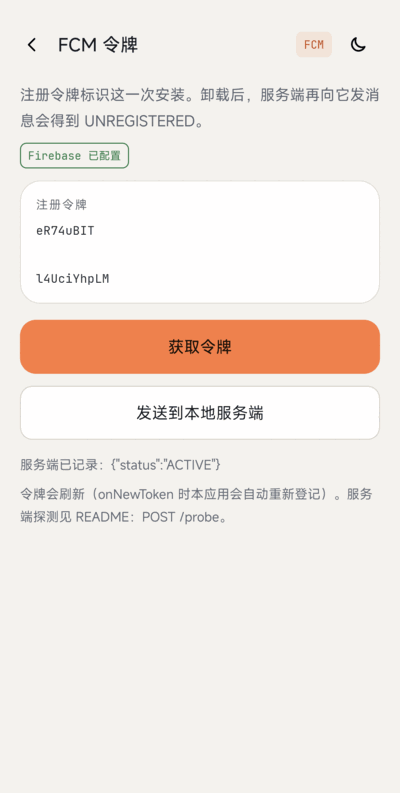
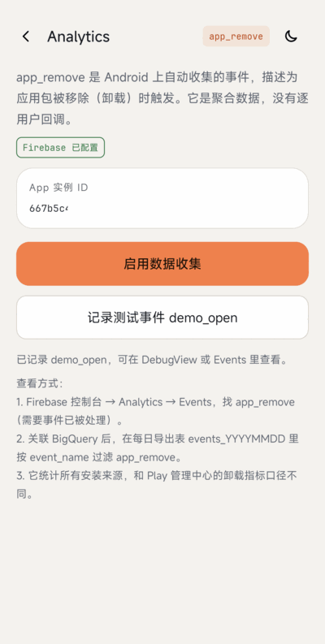
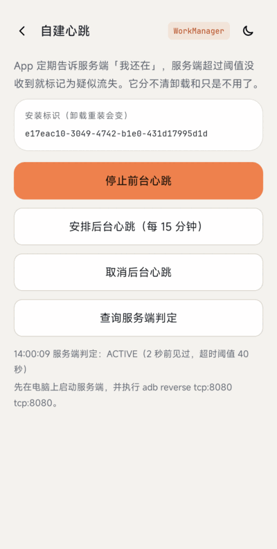
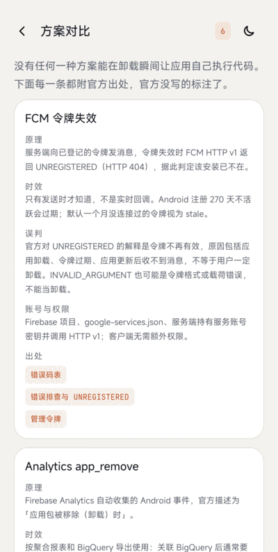
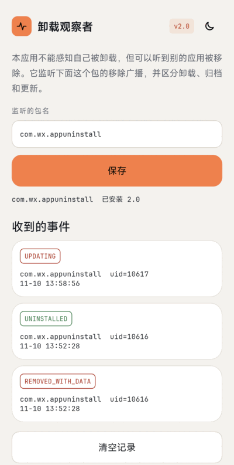
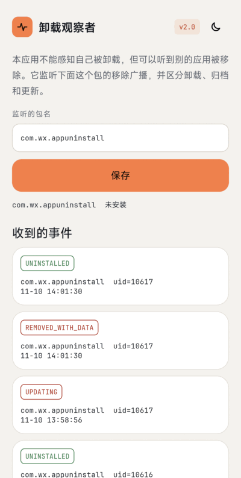

# AppUninstall

[English](README.md)

Android 不会在应用被卸载时回调你的代码，留下的子进程也会随应用一起被杀。本仓库收集的是**今天真正可行**的「感知应用被卸载」方案，做成可以在手机上跑的演示；2016 年的 `fork` + `inotify` 旧演示保留作参考。

| 模块 | 说明 |
|---|---|
| [`app`](app) | 演示 App（`com.wx.appuninstall`）：FCM 令牌、Firebase Analytics `app_remove`、自建心跳，以及附官方出处的方案对比页 |
| [`observer`](observer) | 第二个 App（`com.wx.appuninstall.observer`）：监听别的包被移除，区分卸载、归档和更新 |
| [`server`](server) | 本地服务端（Kotlin / JVM，无第三方依赖）：令牌登记、心跳超时判定、用 FCM HTTP v1 探测并识别 `UNREGISTERED` |
| [`legacy`](legacy) | 2016 年的原生子进程演示，保留作参考；现代 Android 请使用上面的方案，详见 [legacy/README-CN.md](legacy/README-CN.md) |
| [`common`](common) | `app` 与 `observer` 共用的主题、字体和界面工具 |

## 下载

APK 附在[最新版 Release](https://github.com/venshine/AppUninstall/releases/latest) 里（需要 Android 6.0 / API 23 及以上）：

- `AppUninstall-sample-X.Y.apk`：演示 App。构建时没有 `google-services.json`，FCM 和 Analytics 会显示「未配置」；想试这两项，请用自己的 Firebase 项目从源码构建（见[跑起来](#跑起来)）。
- `AppUninstall-observer-X.Y.apk`：观察者 App。
- `AppUninstall-legacy-X.Y.apk`：2016 年的旧演示。

## 截图


| 首页 | 深色 | FCM 令牌 | Analytics |
|:---:|:---:|:---:|:---:|
|  |  |  |  |

| 心跳 | 方案对比 | 观察者 | 观察者收到事件 |
|:---:|:---:|:---:|:---:|
|  |  |  |  |

FCM 令牌已部分打码。2016 年旧演示的截图见 [legacy/README-CN.md](legacy/README-CN.md)。

## 现代替代方案

官方文档里没有「在卸载瞬间于客户端执行代码」的方案，能做的只有事后检测：

| 方案 | 能拿到什么 | 限制 | 出处 |
|---|---|---|---|
| FCM 令牌失效 | 向已卸载应用的令牌发消息时，FCM 可能返回 `UNREGISTERED`（HTTP 404），据此删除令牌并标记流失 | 不实时：只有发送时才知道。官方对 `UNREGISTERED` 的解释是「令牌不再有效」，卸载只是原因之一（还有令牌过期、应用更新后收不到消息）。Android 注册 270 天不活跃过期，一个月未连接视为陈旧 | [管理令牌](https://firebase.google.com/docs/cloud-messaging/manage-tokens)、[排查错误](https://firebase.google.com/docs/cloud-messaging/error-codes)、[错误码](https://firebase.google.com/docs/reference/fcm/rest/v1/ErrorCode) |
| Firebase Analytics `app_remove` | 仅 Android 的自动收集事件，「应用包被移除（卸载）」时记录，可用于报表和 BigQuery | 聚合数据，没有单用户回调；统计所有安装来源，与 Play 管理中心数字不同；BigQuery 数据随每日同步到达 | [自动收集的事件](https://support.google.com/analytics/answer/9234069)、[BigQuery 导出](https://firebase.google.com/docs/projects/bigquery-export)、[导出表结构](https://support.google.com/analytics/answer/7029846) |
| 观察者 App 监听移除广播 | 近实时、按设备：`PACKAGE_FULLY_REMOVED` 会发给其他应用（不发给被移除的包本身） | 用户必须同时装了观察者。见[观察者](#观察者-app) | [Intent 参考](https://developer.android.com/reference/android/content/Intent)、[广播例外清单](https://developer.android.com/develop/background-work/background-tasks/broadcasts/broadcast-exceptions) |
| Google Play 管理中心统计 | 用户 / 设备流失 | 只有聚合数据，没有单用户回调；「流失」也包含超过 30 天未使用的设备 | [Play 管理中心帮助](https://support.google.com/googleplay/android-developer/answer/139628) |
| 自建服务端心跳 | 超时没有心跳就标记为疑似流失 | 启发式：分不清「卸载」和「不使用」；无官方出处（自行设计）。WorkManager 周期任务最小间隔 15 分钟 | [WorkManager](https://developer.android.com/develop/background-work/background-tasks/persistent/getting-started/define-work) |

要收集反馈，建议在应用内（用户离开之前）询问，或通过邮件 / 推送触达仍能联系到的用户。

## 跑起来

### 1. 需要你做的事（Firebase）

没有任何 Firebase 文件时，App 和服务端也能构建运行，FCM 与 Analytics 页显示「未配置」。要用到它们：

1. 在 [Firebase 控制台](https://console.firebase.google.com)新建项目，添加一个**Android 应用**，包名 `com.wx.appuninstall`。`observer` 和 `legacy` 不使用 Firebase，不需要添加。
2. 下载 `google-services.json`，放到 `.private/keys/google-services.json`（已被 git 忽略）。构建时会把它同步到 `app/google-services.json`（同样被忽略），并且只有该文件存在时才应用 `google-services` 插件。
3. 服务端探测需要服务账号密钥：Firebase 控制台 -> 项目设置 -> 服务账号 -> 「生成新的私钥」，保存为 `.private/keys/firebase-service-account.json`，不要提交。
4. 重新构建 App，首页应显示「Firebase 已配置」。

### 2. 启动服务端

```bash
./gradlew :server:run
# 可选环境变量：
#   PORT（8080）  BIND（127.0.0.1）  HEARTBEAT_TIMEOUT_SECONDS（1800）
#   FCM_SERVICE_ACCOUNT（服务账号 JSON 路径，默认 .private/keys/firebase-service-account.json）
```

服务端没有鉴权，只监听回环地址。让手机通过 USB 连到它：

```bash
adb reverse tcp:8080 tcp:8080
```

（[`adb reverse`](https://developer.android.com/tools/adb) 见 `adb help`。）App 访问 `http://127.0.0.1:8080`，`network_security_config.xml` 只对回环地址放行明文（[文档](https://developer.android.com/privacy-and-security/security-config)）。

| 接口 | 作用 |
|---|---|
| `POST /register` `{"installId","token"}` | 登记设备和 FCM 令牌 |
| `POST /heartbeat` `{"installId"}` | 记录一次心跳 |
| `GET /devices` | 设备及状态 `ACTIVE` / `SUSPECTED_CHURN` / `UNINSTALLED` |
| `POST /probe` | 向所有已登记令牌发一条仅含数据的消息，返回 `UNREGISTERED` 即标记为 `UNINSTALLED`。需要服务账号 |

判定规则：`UNINSTALLED`（FCM 返回 `UNREGISTERED`）优先于 `SUSPECTED_CHURN`（心跳超过阈值）优先于 `ACTIVE`；之后只要有登记或心跳，`UNINSTALLED` 标记就会清除。没带 `UNREGISTERED` 细节的 404（例如项目 ID 写错）和 `INVALID_ARGUMENT` **不会**被当成卸载。状态只在内存里。

### 3. 走一遍

1. 安装 `app`，进「FCM 令牌」，点「获取令牌」再点「发送到本地服务端」。
2. 进「自建心跳」，开始前台心跳；「查询服务端判定」可以看到状态。
3. 卸载 App 后执行 `curl -X POST http://127.0.0.1:8080/probe`。FCM 不会在卸载那一刻通知你，只在服务端下次发送时才失败。在 Android 17 真机上，卸载后约 26 秒的第一次探测就返回了 `UNREGISTERED`，见[第 4 节](#4-真机上看到的现象)。
4. 先安装 `observer`，再卸载 `app`：观察者列表里会出现 `UNINSTALLED`。

### 4. 真机上看到的现象

在 Android 17 真机上用 debug 构建实测。

| 步骤 | 现象 |
|---|---|
| 登记 | App 取到 FCM 令牌并登记；`POST /probe` 返回 `Delivered`，App 的 `onMessageReceived` 被执行（App 会记下接收时间）。心跳到达服务端，`GET /devices` 为 `ACTIVE`。 |
| 卸载 | 用 `adb shell am start -a android.intent.action.DELETE -d package:com.wx.appuninstall` 打开系统卸载确认框，点「卸载」。点击后 App 进程随即结束。 |
| 约 26 秒后 | 卸载后的第一次 `POST /probe` 返回 `Unregistered`，服务端把设备标成 `UNINSTALLED`。 |
| 点击之后 | 没有浏览器被拉起：前台一直是系统安装器。 |

确认框和结果页的录屏：[`screenshot/uninstall_dialog.gif`](screenshot/uninstall_dialog.gif)。

观察者（已安装、打开过一次，监听 `com.wx.appuninstall`）：

- 观察者在后台（卸载确认框在前台）时，系统暂扣了 `PACKAGE_FULLY_REMOVED`，没有记录到事件。
- 观察者页面打开时，用 `adb shell pm uninstall com.wx.appuninstall`，同一秒内出现 `REMOVED_WITH_DATA` 和 `UNINSTALLED`。
- 观察者自己的「已安装 / 未安装」一行（`<queries>` 包可见性）在卸载前后都正确。

Analytics：用 `adb shell setprop debug.firebase.analytics.app com.wx.appuninstall` 后，测试事件 `demo_open` 可在 Firebase 控制台 Analytics 的 DebugView 查看。卸载时会记录 `app_remove`，控制台里稍后出现。

## 观察者 App

`observer` 在清单里静态注册 `android.intent.action.PACKAGE_FULLY_REMOVED`，默认监听 `com.wx.appuninstall`（可在界面里改）。

- **用哪个广播。**`PACKAGE_FULLY_REMOVED` 只在 `PACKAGE_REMOVED` 的 `EXTRA_DATA_REMOVED` 为 true 且 `EXTRA_REPLACING` 为 false 时发出（[Intent 参考](https://developer.android.com/reference/android/content/Intent)）。被移除的包自己收不到 `PACKAGE_REMOVED`。
- **Android 8 隐式广播限制。**例外清单列出了 `PACKAGE_FULLY_REMOVED`（和 `PACKAGE_DATA_CLEARED`），并说明 `PACKAGE_REPLACED` 等其他包广播不在例外内（[文档](https://developer.android.com/develop/background-work/background-tasks/broadcasts/broadcast-exceptions)）。`PACKAGE_REMOVED` 不在清单里，所以只在页面打开期间动态注册。
- **归档与卸载（Android 15）。**`EXTRA_ARCHIVAL`（API 35）标记归档产生的 `PACKAGE_ADDED` / `PACKAGE_REMOVED`；归档会移除 APK 和缓存，**保留用户数据**（[`PackageInstaller.requestArchive`](https://developer.android.com/reference/android/content/pm/PackageInstaller)）。由这两条可推出归档不应产生需要数据被移除的 `PACKAGE_FULLY_REMOVED`。解析时仍先判 `EXTRA_ARCHIVAL`，所以归档不会被记成卸载。
- **包可见性（Android 11）。**清单声明了 `<queries><package android:name="com.wx.appuninstall"/></queries>`，用于查询目标是否已安装（[文档](https://developer.android.com/training/package-visibility)）。包可见性是否影响广播投递，**官方文档没有明说**；测试机上声明该条目时广播到达了。
- **局限。**在 Android 17 测试机上，观察者处于后台时广播被系统暂扣（见第 4 节），不要只靠观察者一种手段。

## 构建与测试

```bash
./gradlew :legacy:testDebugUnitTest :legacy:assembleDebug \
          :app:testDebugUnitTest :app:assembleDebug :app:lintDebug \
          :observer:testDebugUnitTest :observer:assembleDebug :observer:lintDebug \
          :server:test
```

AGP 9.4.1、Gradle 9.8.2、Kotlin 2.2.10、compileSdk / targetSdk 36、minSdk 23。有意使用 Firebase BoM 34.19.0：BoM 35.x 的库带 Kotlin 2.4 元数据，当前 Kotlin 版本读不了。WorkManager 用 2.11.2，因为 2.12 要求 minSdk 24。

单元测试覆盖：服务端判定与 FCM 响应解析（离线，响应按文档字段构造）、心跳超时规则、观察者的广播解析，以及每个页面在浅色 / 深色下的 Robolectric 冒烟测试。

## About
* Email：venshine.cn@gmail.com

## 致谢

`app`、`observer`、`legacy` 内置了下面两套字体，均采用 [SIL Open Font License 1.1](https://openfontlicense.org)（协议原文见 [`common/licenses/`](common/licenses)）：

* [Space Grotesk](https://github.com/floriankarsten/space-grotesk)：Copyright 2020 The Space Grotesk Project Authors
* [JetBrains Mono](https://github.com/JetBrains/JetBrainsMono)：Copyright 2020 The JetBrains Mono Project Authors

## License
    Copyright (C) 2016 venshine.cn@gmail.com

    Licensed under the Apache License, Version 2.0 (the "License");
    you may not use this file except in compliance with the License.
    You may obtain a copy of the License at

    http://www.apache.org/licenses/LICENSE-2.0

    Unless required by applicable law or agreed to in writing, software
    distributed under the License is distributed on an "AS IS" BASIS,
    WITHOUT WARRANTIES OR CONDITIONS OF ANY KIND, either express or implied.
    See the License for the specific language governing permissions and
    limitations under the License.
