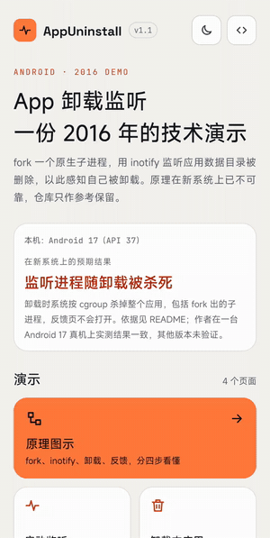
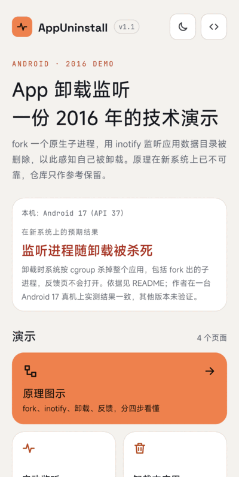
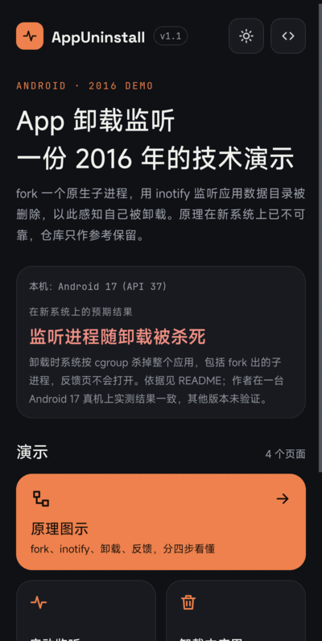
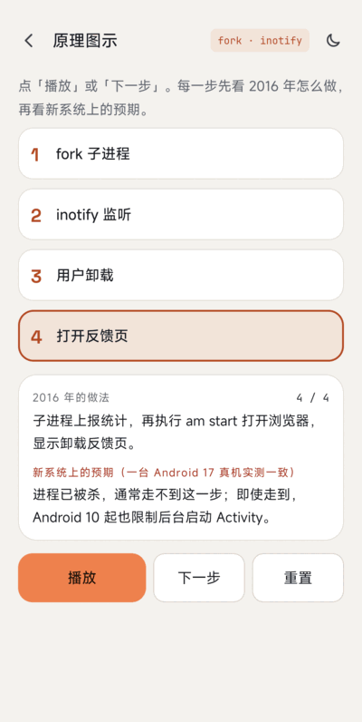
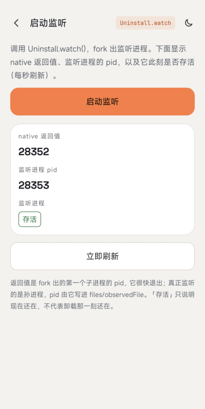
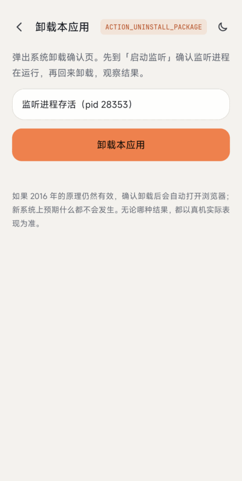

# AppUninstall

[English](README.md)

> **这是 2016 年的技术演示，其原理在现代 Android 上已不可靠。**
> 它为 Android 4.x / 5.x 编写，现在仍保留开放作参考，并能用当前工具链编译，但不是可用于生产的方案。详见[现代 Android 上的限制](#现代-android-上的限制)和[现代替代方案](#现代替代方案)。

通过 `fork()` 出一个原生子进程，用 `inotify` 监听 `/data/data/<包名>`，在应用被卸载后打开反馈网页 / 上报统计，从而实现「监听自身卸载」。

## 截图



| 首页 | 深色模式 | 原理图示 |
|:---:|:---:|:---:|
|  |  |  |

| 启动监听 | 卸载本应用 | 替代方案 |
|:---:|:---:|:---:|
|  |  |  |

[示例 App](app) 有五个页面，支持浅色和深色。卸载实测录屏见 [`screenshot/uninstall.gif`](screenshot/uninstall.gif)。

## 原理（原始设计）

1. 监听系统卸载广播：收不到自己的卸载广播（`ACTION_PACKAGE_REMOVED` 不会发给正在被移除的包，见 [Intent 文档](https://developer.android.com/reference/android/content/Intent#ACTION_PACKAGE_REMOVED)）。
2. Java 线程：卸载时进程退出，线程随之销毁。
3. 用 `fork()`（配合 `setsid()` 脱离）创建的 C 子进程，在老系统上不会随应用一起被杀；它用 [inotify](https://man7.org/linux/man-pages/man7/inotify.7.html) 监听应用数据目录下的文件，目录被删除即认为已卸载，随后上报并打开浏览器。

实现步骤：`fork()` 子进程 -> 创建监听文件和锁文件（`flock`，保证只有一个监听进程）-> `inotify_init` + `inotify_add_watch` -> `read` 阻塞 -> 收到 `IN_DELETE_SELF` 后再判断应用目录是否还在（区分「清除数据」和「卸载」）-> 发送统计请求 -> 执行 `am start -a android.intent.action.VIEW -d <url>`。

`uninstall.cpp` 里的反馈地址 `www.baidu.com` 只是占位。

## 现代 Android 上的限制

### 真机实测

只在一台设备上测过一次：Xiaomi 2509FPN0BC，Android 17（API 37，HyperOS 版本 `OS4.0.5.0.XPBCNXM`），debug 包，2026-11-09。以下现象没有在其他设备或其他 Android 版本上验证。

1. 在示例里点「启动监听」。`Uninstall.watch()` 返回的是很快退出的第一个子进程 pid；`ps -A` 显示真正的监听进程是孙进程（pid 24738，父进程 pid 1），和应用进程（pid 24581）同时存在，页面显示「存活」。
2. 点示例里的「卸载本应用」，在系统卸载确认框里确认（录屏：[`screenshot/uninstall.gif`](screenshot/uninstall.gif)）。
3. 结果：应用被卸载，该包没有任何进程残留（`ps -A` 查不到，`pm list packages` 不再列出）。`logcat` 记录了 `ActivityManager: Killing 24581:com.wx.appuninstall/u0a613 (adj 700): stop com.wx.appuninstall due to deletePackageX`、`kill: send 9 to pid -24581`，约 35 毫秒后 `Process PhantomProcessRecord {... 24738:24581:com.wx.appuninstall/u0a613} died`，即监听进程与应用同时被杀。
4. 确认卸载后的 15 秒内，前台窗口一直是卸载前打开的另一个应用（没有浏览器窗口到前台），`logcat` 里除系统安装器自己的卸载界面外没有其他 Activity 启动。测试开始前系统里已有 `com.android.browser` 进程，pid 不变，没有被拉到前台。

所以在这台设备上：监听进程没有在卸载后存活，也没有打开反馈页。

### 一手来源给出的预期

以下结论来自[现代替代方案](#现代替代方案)一节列出的一手来源：

- **子进程会随应用一起被杀。** 包被移除时系统会杀掉其进程（`PackageFreezer` 调用 `killApplication`），杀进程走按 UID / PID 划分的 cgroup（`killProcessGroup`），不依赖进程组或会话，所以 `setsid()` 无效。具体从哪个 Android 版本开始生效：待确认（上面的真机测试只覆盖 Android 17）。
- **后台打开浏览器受限。** 自 Android 10（API 29）起，应用除少数例外情况外不能从后台启动 Activity（[文档](https://developer.android.com/guide/components/activities/background-starts)），脱离的原生进程执行 `am start` 不在例外列表内。
- **硬编码 `/data/data/<包名>`。** 代码只考虑了用户 0；多用户下路径是 `/data/user/<id>/<包名>`，文档也说明应用目录路径可能变化（例如迁到 adopted storage），不应写死。
- 旧说明里「清除数据、kill 进程 5.0 以上不支持」同样源于第一条。
- Issue #3（卸载后删除 SD 卡目录）不处理：它依赖同一个能存活的子进程，按上述限制已不成立。建议把文件放在应用专属外部目录（`getExternalFilesDir()`），不要放共享目录，以便系统随应用清理（本项目未验证）。

本版本的编译修复：`flock` 需要 `#include <sys/file.h>`（issue #4 / #5）；`open(..., O_CREAT)` 必须带 mode 参数；Gradle 的 `cmake {}` 要写在 `defaultConfig` 的 `externalNativeBuild` 里（issue #8）；已弃用的 `com.wx.android.common` 依赖换成系统 API。

## 现代替代方案

官方文档里没有「在卸载瞬间于客户端可靠执行代码」的方案，能做的只有事后的服务端或聚合检测：

| 方案 | 能拿到什么 | 限制 | 出处 |
|---|---|---|---|
| FCM 令牌失效 | 向已卸载应用的令牌发消息时，FCM 可能返回 `UNREGISTERED`（HTTP 404），据此删除令牌并标记流失 | 不实时：只有发送时才知道；Android 注册 270 天不活跃过期，一个月未连接视为陈旧 | [管理令牌](https://firebase.google.com/docs/cloud-messaging/manage-tokens)、[错误码](https://firebase.google.com/docs/reference/fcm/rest/v1/ErrorCode) |
| Firebase Analytics `app_remove` | 仅 Android 的自动收集事件，「应用包被移除（卸载）」时记录，可用于受众 / BigQuery | 聚合分析数据；统计所有安装来源，与 Play 管理中心数字不同 | [自动收集的事件](https://support.google.com/analytics/answer/9234069) |
| Google Play 管理中心统计 | 用户 / 设备流失、按设备 / 按用户的卸载数 | 只有聚合数据，没有单用户回调，仅限 Play 安装 | [Play 管理中心帮助](https://support.google.com/googleplay/android-developer/answer/139628) |
| 自建服务端心跳 | 连续 N 天无心跳则判定用户可能已流失 | 启发式：分不清「卸载」和「不使用」；无官方出处（自行设计） | -- |

要收集反馈，建议在应用内（用户离开之前）询问，或通过邮件 / 推送触达仍能联系到的用户。

## 构建

```
./gradlew :app:testDebugUnitTest :app:assembleDebug :app:lintDebug
```

AGP 9.4.1、Gradle 9.8.2、compileSdk / targetSdk 36、minSdk 23、NDK `28.2.13676358`、CMake 3.22.1。

## 参考
* [http://www.cnblogs.com/zealotrouge/p/3182617.html](http://www.cnblogs.com/zealotrouge/p/3182617.html)
* [http://www.jianshu.com/p/189e319a5c45](http://www.jianshu.com/p/189e319a5c45)
* [http://blog.csdn.net/allen315410/article/details/42555415](http://blog.csdn.net/allen315410/article/details/42555415)
* [http://www.netzmafia.de/skripten/unix/linux-daemon-howto.html](http://www.netzmafia.de/skripten/unix/linux-daemon-howto.html)

## About
* Email：venshine.cn@gmail.com

## 致谢

示例 App 内置了下面两套字体，均采用 [SIL Open Font License 1.1](https://openfontlicense.org)（协议原文见 [`app/licenses/`](app/licenses)）：

* [Space Grotesk](https://github.com/floriankarsten/space-grotesk)：Copyright 2020 The Space Grotesk Project Authors
* [JetBrains Mono](https://github.com/JetBrains/JetBrainsMono)：Copyright 2020 The JetBrains Mono Project Authors

## License
    Copyright (C) 2016 venshine.cn@gmail.com

    Licensed under the Apache License, Version 2.0 (the "License");
    you may not use this file except in compliance with the License.
    You may obtain a copy of the License at

    http://www.apache.org/licenses/LICENSE-2.0

    Unless required by applicable law or agreed to in writing, software
    distributed under the License is distributed on an "AS IS" BASIS,
    WITHOUT WARRANTIES OR CONDITIONS OF ANY KIND, either express or implied.
    See the License for the specific language governing permissions and
    limitations under the License.
