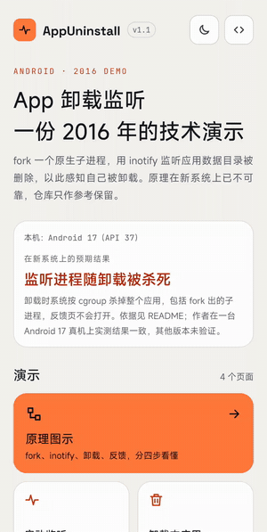
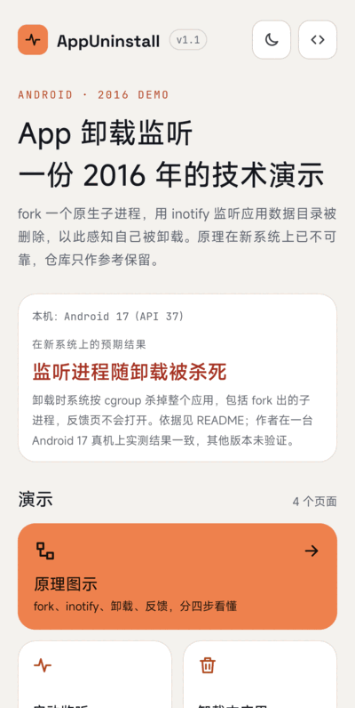
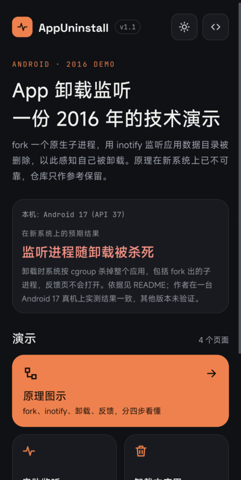
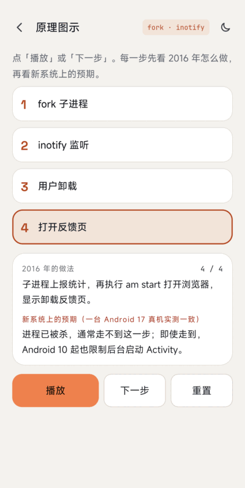
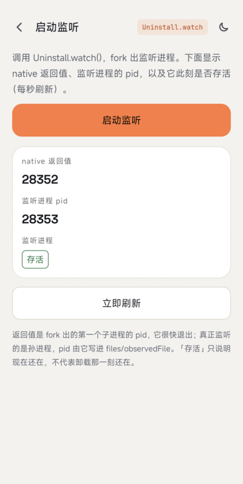
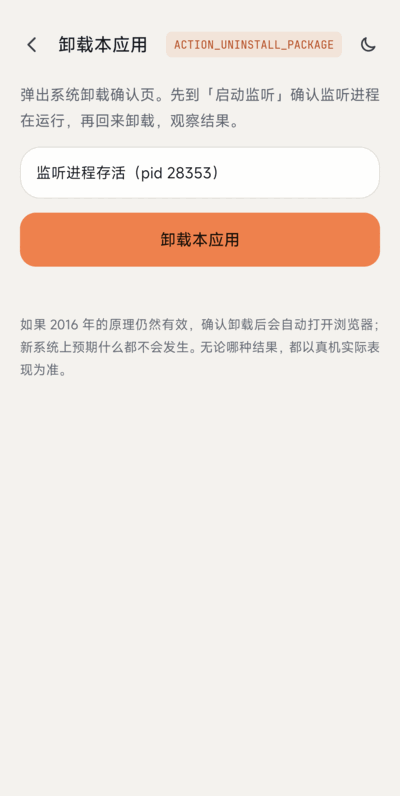
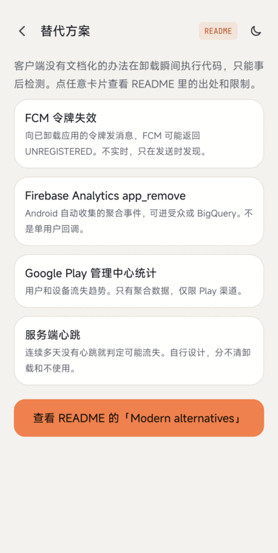

# AppUninstall

[中文](README-CN.md)

> **This is a 2016 technology demo. Its principle is no longer reliable on modern Android.**
> It was written for Android 4.x/5.x. It is kept open as a reference and builds with current tooling, but it is not a production solution. See [Limitations](#limitations-on-modern-android) and [Modern alternatives](#modern-alternatives).

Detect your own app being uninstalled on Android by forking a native process that watches `/data/data/<package>` with `inotify`, then opens a feedback page / reports statistics.

## ScreenShot



| Home | Dark mode | Principle |
|:---:|:---:|:---:|
|  |  |  |

| Start listening | Uninstall | Alternatives |
|:---:|:---:|:---:|
|  |  |  |

The [sample app](app) has five pages, with light and dark themes. The uninstall test is recorded in [`screenshot/uninstall.gif`](screenshot/uninstall.gif).

## Principle (as originally designed)

1. A broadcast receiver cannot hear its own uninstall (`ACTION_PACKAGE_REMOVED` is not delivered to the package being removed, see the [Intent docs](https://developer.android.com/reference/android/content/Intent#ACTION_PACKAGE_REMOVED)).
2. Java threads die with the process when the app is uninstalled.
3. A native child process created with `fork()` (and detached with `setsid()`) was, on old systems, not killed together with the app. It watches a file under the app's data directory with [inotify](https://man7.org/linux/man-pages/man7/inotify.7.html); when the directory is deleted, it reports and opens a browser.

Steps: `fork()` a child -> create the observed file and a lock file (`flock`, one watcher only) -> `inotify_init` + `inotify_add_watch` -> block in `read` -> on `IN_DELETE_SELF` re-check the app directory (to tell "clear data" from "uninstall") -> send the statistics request -> run `am start -a android.intent.action.VIEW -d <url>`.

The feedback URL in `uninstall.cpp` is the placeholder `www.baidu.com`.

## Limitations on modern Android

### Observed on a real device

Tested once on one device: Xiaomi 2509FPN0BC, Android 17 (API 37, HyperOS build `OS4.0.5.0.XPBCNXM`), debug build, 2026-11-09. Nothing below is verified on any other device or Android version.

1. Opened "Start listening". `Uninstall.watch()` returned the pid of a short-lived first child; `ps -A` showed the real watcher as a grandchild (pid 24738, parent pid 1) next to the app process (pid 24581), and the page showed it alive.
2. Tapped "Uninstall this app" in the sample and confirmed the system uninstall dialog (screen recording: [`screenshot/uninstall.gif`](screenshot/uninstall.gif)).
3. Result: the app was removed and no process of the package was left (`ps -A` empty, `pm list packages` no longer listed it). `logcat` shows `ActivityManager: Killing 24581:com.wx.appuninstall/u0a613 (adj 700): stop com.wx.appuninstall due to deletePackageX`, `kill: send 9 to pid -24581`, and about 35 ms after the kill `Process PhantomProcessRecord {... 24738:24581:com.wx.appuninstall/u0a613} died`, i.e. the watcher was killed together with the app.
4. During the 15 seconds after confirming, the foreground window stayed on the app that was open before (no browser window came to the front), and `logcat` contains no activity start other than the system installer's own uninstall screens. A `com.android.browser` process was running before the test started and stayed the same pid; it was not brought to the front.

So on this device the watcher did not survive the uninstall and no feedback page was opened.

### Expected from primary sources

Based on the primary sources listed in the [Modern alternatives](#modern-alternatives) section:

- **Child processes are killed with the app.** When a package is removed, the system kills its processes (`PackageFreezer` calls `killApplication`), and the process kill goes through the per-UID/PID cgroup (`killProcessGroup`), which does not depend on process group or session membership, so `setsid()` does not help. The exact Android version where this became effective is unverified (the device test above only covers Android 17).
- **Opening a browser from the background is restricted.** Since Android 10 (API 29) apps cannot start activities from the background except in a short list of cases ([docs](https://developer.android.com/guide/components/activities/background-starts)). A native `am start` from a detached process is not in that list.
- **Hard-coded `/data/data/<package>`.** The code assumes user 0. Secondary users use `/data/user/<id>/<package>`, and the docs say app paths may change (for example, when moved to adopted storage), so they should not be hard-coded.
- **Clear data / force stop** behavior listed in the old notes ("not supported on 5.0+") is a consequence of the first point.
- Issue #3 (delete the app's SD card folder after uninstall) is not handled: it relies on the same surviving child process, which the limitations above rule out. Prefer app-specific external directories (`getExternalFilesDir()`) over shared folders so the system can clean them with the app (unverified here).

Build fixes in this version: `flock` needs `#include <sys/file.h>` (issues #4 / #5), `open(..., O_CREAT)` needs a mode argument, the Gradle `cmake {}` block belongs under `externalNativeBuild` in `defaultConfig` (issue #8), and the abandoned `com.wx.android.common` dependency was replaced with platform APIs.

## Modern alternatives

There is no documented client-side way to run code at the moment of uninstall. What exists is server-side or aggregated detection after the fact:

| Approach | What you get | Limits | Source |
|---|---|---|---|
| FCM token becomes invalid | When you send a message to a token of an uninstalled app, FCM can return `UNREGISTERED` (HTTP 404); delete the token and mark the user as churned | Not immediate: only seen on a send; Android registrations inactive for 270 days are expired, stale after a month without connecting | [Manage tokens](https://firebase.google.com/docs/cloud-messaging/manage-tokens), [Error codes](https://firebase.google.com/docs/reference/fcm/rest/v1/ErrorCode) |
| Firebase Analytics `app_remove` | Android-only automatically collected event "when an application package is removed (uninstalled)", usable as an audience / BigQuery signal | Aggregated analytics; counts all installation sources and differs from Play Console numbers | [Automatically collected events](https://support.google.com/analytics/answer/9234069) |
| Google Play Console statistics | User / device loss, uninstalls by device / user | Aggregates only, no per-user callback, Play-installed apps only | [Play Console help](https://support.google.com/googleplay/android-developer/answer/139628) |
| Your own server heartbeat | Mark a user as likely churned after N days without a heartbeat | A heuristic: cannot tell "uninstalled" from "not using"; no official source (own design) | -- |

For collecting feedback, ask inside the app (before the user leaves) or follow up through email / push to users you can still reach.

## Build

```
./gradlew :app:testDebugUnitTest :app:assembleDebug :app:lintDebug
```

AGP 9.4.1, Gradle 9.8.2, compileSdk / targetSdk 36, minSdk 23, NDK `28.2.13676358`, CMake 3.22.1.

## References

* [http://www.cnblogs.com/zealotrouge/p/3182617.html](http://www.cnblogs.com/zealotrouge/p/3182617.html)
* [http://www.jianshu.com/p/189e319a5c45](http://www.jianshu.com/p/189e319a5c45)
* [http://blog.csdn.net/allen315410/article/details/42555415](http://blog.csdn.net/allen315410/article/details/42555415)
* [http://www.netzmafia.de/skripten/unix/linux-daemon-howto.html](http://www.netzmafia.de/skripten/unix/linux-daemon-howto.html)

## About
* Email: venshine.cn@gmail.com

## Credits

The sample app bundles these fonts, both licensed under the [SIL Open Font License 1.1](https://openfontlicense.org) (license texts in [`app/licenses/`](app/licenses)):

* [Space Grotesk](https://github.com/floriankarsten/space-grotesk): Copyright 2020 The Space Grotesk Project Authors
* [JetBrains Mono](https://github.com/JetBrains/JetBrainsMono): Copyright 2020 The JetBrains Mono Project Authors

## License
    Copyright (C) 2016 venshine.cn@gmail.com

    Licensed under the Apache License, Version 2.0 (the "License");
    you may not use this file except in compliance with the License.
    You may obtain a copy of the License at

    http://www.apache.org/licenses/LICENSE-2.0

    Unless required by applicable law or agreed to in writing, software
    distributed under the License is distributed on an "AS IS" BASIS,
    WITHOUT WARRANTIES OR CONDITIONS OF ANY KIND, either express or implied.
    See the License for the specific language governing permissions and
    limitations under the License.
