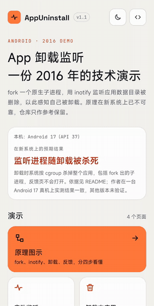
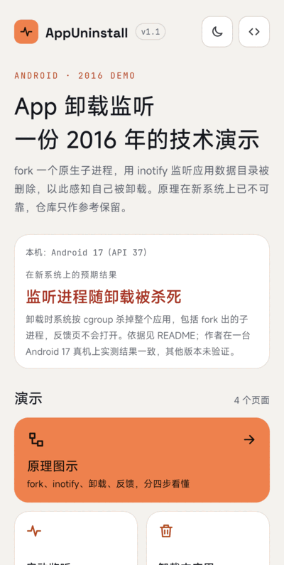
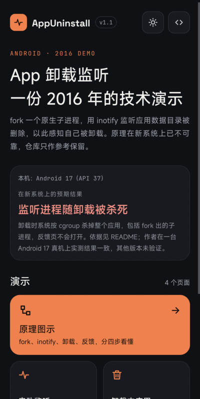
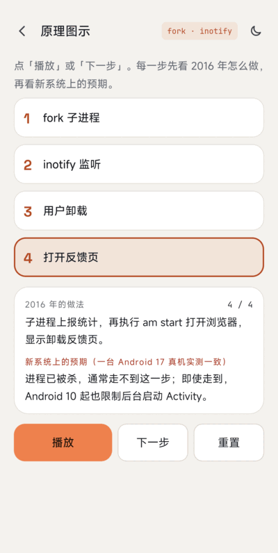
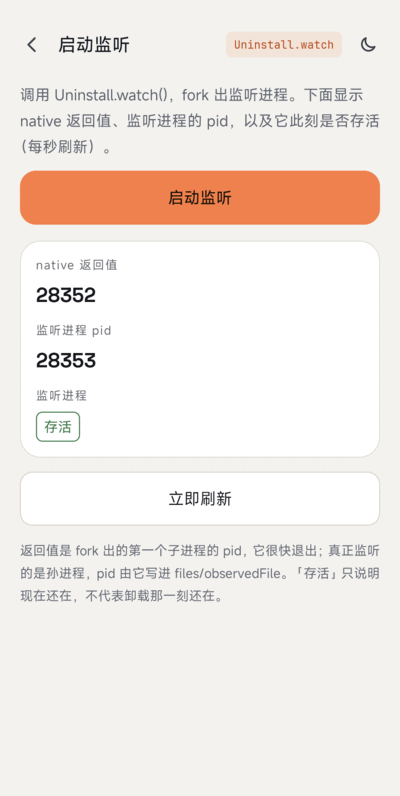
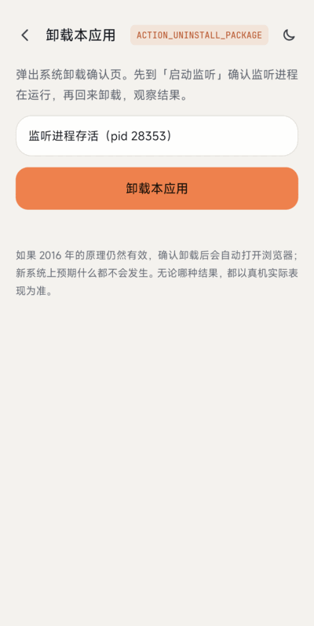
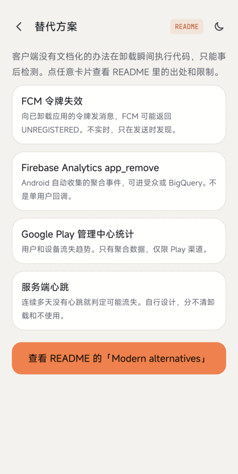

# AppUninstall legacy 模块

[返回主 README](../README-CN.md) | [English](README.md)

> **这是 2016 年的技术演示，原样保留作参考，现代 Android 请使用[主 README](../README-CN.md#现代替代方案) 中的方案。**
> 原生代码和 Java 封装是原版，只更新了构建。现在能用的方案见[主 README](../README-CN.md#现代替代方案)。

通过 `fork()` 出一个原生子进程，用 `inotify` 监听 `/data/data/<包名>`，实现「监听自身卸载」。

**2.0 的变化：**本模块安装后的包名是 `com.wx.appuninstall.legacy`（`com.wx.appuninstall` 归新 App 使用），`uninstall.cpp` 里写死的四个数据目录路径随之改了。Java 包名和 native 符号不变。下面的真机现象是用 1.1 版、旧包名测的；改名后的构建没有重新上真机测试。

## 截图



| 首页 | 深色模式 | 原理图示 |
|:---:|:---:|:---:|
|  |  |  |

| 启动监听 | 卸载本应用 | 替代方案 |
|:---:|:---:|:---:|
|  |  |  |

[示例 App](src/main/java/com/wx/appuninstall) 有五个页面，支持浅色和深色。卸载实测录屏见 [`../screenshot/legacy/uninstall.gif`](../screenshot/legacy/uninstall.gif)。

## 原理（原始设计）

1. 监听系统卸载广播：收不到自己的卸载广播（`ACTION_PACKAGE_REMOVED` 不会发给正在被移除的包，见 [Intent 文档](https://developer.android.com/reference/android/content/Intent#ACTION_PACKAGE_REMOVED)）。
2. Java 线程：卸载时进程退出，线程随之销毁。
3. 用 `fork()`（配合 `setsid()` 脱离）创建的 C 子进程，在老系统上不会随应用一起被杀；它用 [inotify](https://man7.org/linux/man-pages/man7/inotify.7.html) 监听应用数据目录下的文件，目录被删除即认为已卸载，随后上报并打开浏览器。

实现步骤：`fork()` 子进程 -> 创建监听文件和锁文件（`flock`，保证只有一个监听进程）-> `inotify_init` + `inotify_add_watch` -> `read` 阻塞 -> 收到 `IN_DELETE_SELF` 后再判断应用目录是否还在（区分「清除数据」和「卸载」）-> 发送统计请求 -> 执行 `am start -a android.intent.action.VIEW -d <url>`。

`uninstall.cpp` 里的反馈地址 `www.baidu.com` 只是占位。

## 现代 Android 上的限制

### 真机实测

在 Android 17 真机上用 debug 包实测。

1. 在示例里点「启动监听」。`Uninstall.watch()` 返回的是很快退出的第一个子进程 pid；`ps -A` 显示真正的监听进程是孙进程（pid 24738，父进程 pid 1），和应用进程（pid 24581）同时存在，页面显示「存活」。
2. 点示例里的「卸载本应用」，在系统卸载确认框里确认（录屏：[`../screenshot/legacy/uninstall.gif`](../screenshot/legacy/uninstall.gif)）。
3. 结果：应用被卸载，该包没有任何进程残留（`ps -A` 查不到，`pm list packages` 不再列出）。`logcat` 记录了 `ActivityManager: Killing 24581:com.wx.appuninstall/u0a613 (adj 700): stop com.wx.appuninstall due to deletePackageX`、`kill: send 9 to pid -24581`，约 35 毫秒后 `Process PhantomProcessRecord {... 24738:24581:com.wx.appuninstall/u0a613} died`，即监听进程与应用同时被杀。
4. 确认卸载后的 15 秒内，前台窗口一直是卸载前打开的另一个应用（没有浏览器窗口到前台），`logcat` 里除系统安装器自己的卸载界面外没有其他 Activity 启动。测试开始前系统里已有 `com.android.browser` 进程，pid 不变，没有被拉到前台。

所以在 Android 17 上：监听进程没有在卸载后存活，也没有打开反馈页。

### 一手来源给出的预期

以下结论来自[现代替代方案](../README-CN.md#现代替代方案)一节列出的一手来源：

- **子进程会随应用一起被杀。** 包被移除时系统会杀掉其进程（`PackageFreezer` 调用 `killApplication`），杀进程走按 UID / PID 划分的 cgroup（`killProcessGroup`），不依赖进程组或会话，所以 `setsid()` 无效。
- **后台打开浏览器受限。** 自 Android 10（API 29）起，应用除少数例外情况外不能从后台启动 Activity（[文档](https://developer.android.com/guide/components/activities/background-starts)），脱离的原生进程执行 `am start` 不在例外列表内。
- **硬编码 `/data/data/<包名>`。** 代码只考虑了用户 0；多用户下路径是 `/data/user/<id>/<包名>`，文档也说明应用目录路径可能变化（例如迁到 adopted storage），不应写死。
- 旧说明里「清除数据、kill 进程 5.0 以上不支持」同样源于第一条。
- Issue #3（卸载后删除 SD 卡目录）不处理：它依赖同一个能存活的子进程，按上述限制已不成立。建议把文件放在应用专属外部目录（`getExternalFilesDir()`），不要放共享目录，以便系统随应用清理。

本版本的编译修复：`flock` 需要 `#include <sys/file.h>`（issue #4 / #5）；`open(..., O_CREAT)` 必须带 mode 参数；Gradle 的 `cmake {}` 要写在 `defaultConfig` 的 `externalNativeBuild` 里（issue #8）；已弃用的 `com.wx.android.common` 依赖换成系统 API。

## 构建

```
./gradlew :legacy:testDebugUnitTest :legacy:assembleDebug :legacy:lintDebug
```

NDK `28.2.13676358`、CMake 3.22.1。

## 参考
* [http://www.cnblogs.com/zealotrouge/p/3182617.html](http://www.cnblogs.com/zealotrouge/p/3182617.html)
* [http://www.jianshu.com/p/189e319a5c45](http://www.jianshu.com/p/189e319a5c45)
* [http://blog.csdn.net/allen315410/article/details/42555415](http://blog.csdn.net/allen315410/article/details/42555415)
* [http://www.netzmafia.de/skripten/unix/linux-daemon-howto.html](http://www.netzmafia.de/skripten/unix/linux-daemon-howto.html)

