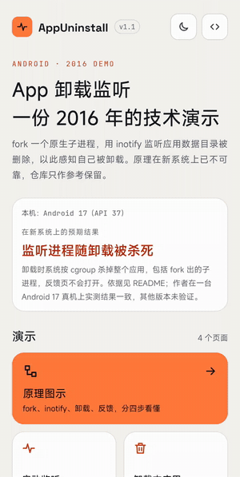
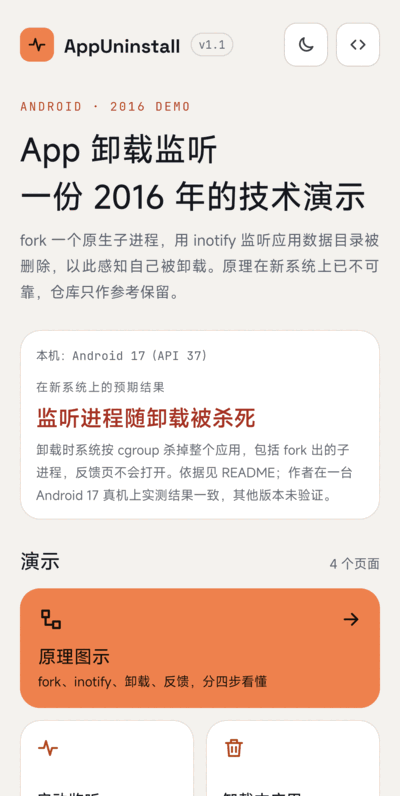
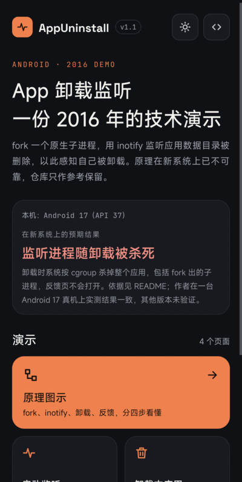
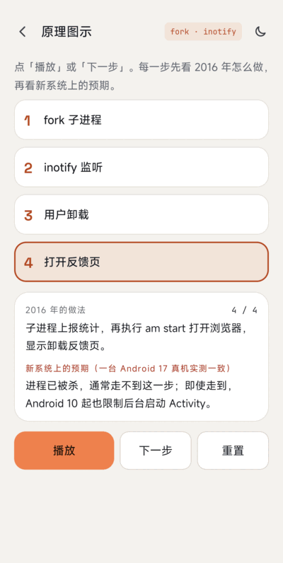
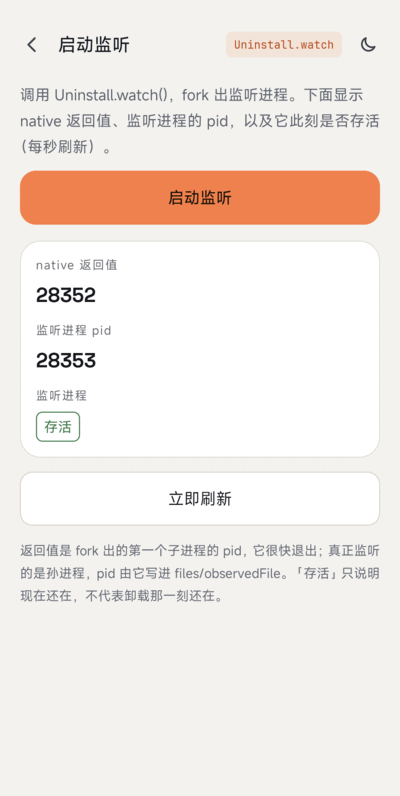
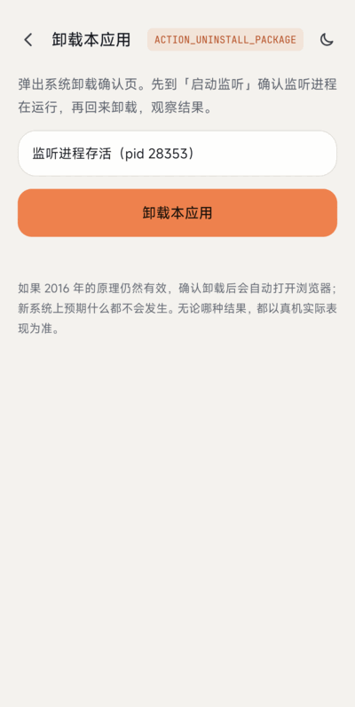
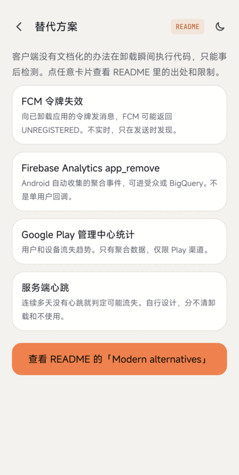

# AppUninstall legacy module

[Back to the main README](../README.md) | [中文](README-CN.md)

> **This is the 2016 technology demo, kept unchanged as a reference. On modern Android, use the approaches in the [main README](../README.md#modern-alternatives).**
> The native code and the Java wrapper are the original; only the build was updated. For solutions that work today, see the [main README](../README.md#modern-alternatives).

Detect your own app being uninstalled by forking a native process that watches `/data/data/<package>` with `inotify`.

**Note on 2.0:** the module now installs as `com.wx.appuninstall.legacy` (the `com.wx.appuninstall` id belongs to the new app), and the four hard-coded data paths in `uninstall.cpp` were changed to match. The Java package and native symbols are unchanged. The device observations below were made with release 1.1 under the old application id; the renamed build has not been re-tested on a device.

## ScreenShot



| Home | Dark mode | Principle |
|:---:|:---:|:---:|
|  |  |  |

| Start listening | Uninstall | Alternatives |
|:---:|:---:|:---:|
|  |  |  |

The [sample app](src/main/java/com/wx/appuninstall) has five pages, with light and dark themes. The uninstall test is recorded in [`../screenshot/legacy/uninstall.gif`](../screenshot/legacy/uninstall.gif).

## Principle (as originally designed)

1. A broadcast receiver cannot hear its own uninstall (`ACTION_PACKAGE_REMOVED` is not delivered to the package being removed, see the [Intent docs](https://developer.android.com/reference/android/content/Intent#ACTION_PACKAGE_REMOVED)).
2. Java threads die with the process when the app is uninstalled.
3. A native child process created with `fork()` (and detached with `setsid()`) was, on old systems, not killed together with the app. It watches a file under the app's data directory with [inotify](https://man7.org/linux/man-pages/man7/inotify.7.html); when the directory is deleted, it reports and opens a browser.

Steps: `fork()` a child -> create the observed file and a lock file (`flock`, one watcher only) -> `inotify_init` + `inotify_add_watch` -> block in `read` -> on `IN_DELETE_SELF` re-check the app directory (to tell "clear data" from "uninstall") -> send the statistics request -> run `am start -a android.intent.action.VIEW -d <url>`.

The feedback URL in `uninstall.cpp` is the placeholder `www.baidu.com`.

## Limitations on modern Android

### Observed on a real device

Tested on a real device running Android 17 with a debug build.

1. Opened "Start listening". `Uninstall.watch()` returned the pid of a short-lived first child; `ps -A` showed the real watcher as a grandchild (pid 24738, parent pid 1) next to the app process (pid 24581), and the page showed it alive.
2. Tapped "Uninstall this app" in the sample and confirmed the system uninstall dialog (screen recording: [`../screenshot/legacy/uninstall.gif`](../screenshot/legacy/uninstall.gif)).
3. Result: the app was removed and no process of the package was left (`ps -A` empty, `pm list packages` no longer listed it). `logcat` shows `ActivityManager: Killing 24581:com.wx.appuninstall/u0a613 (adj 700): stop com.wx.appuninstall due to deletePackageX`, `kill: send 9 to pid -24581`, and about 35 ms after the kill `Process PhantomProcessRecord {... 24738:24581:com.wx.appuninstall/u0a613} died`, i.e. the watcher was killed together with the app.
4. During the 15 seconds after confirming, the foreground window stayed on the app that was open before (no browser window came to the front), and `logcat` contains no activity start other than the system installer's own uninstall screens. A `com.android.browser` process was running before the test started and stayed the same pid; it was not brought to the front.

So on Android 17 the watcher did not survive the uninstall and no feedback page was opened.

### Expected from primary sources

Based on the primary sources listed in the [Modern alternatives](../README.md#modern-alternatives) section:

- **Child processes are killed with the app.** When a package is removed, the system kills its processes (`PackageFreezer` calls `killApplication`), and the process kill goes through the per-UID/PID cgroup (`killProcessGroup`), which does not depend on process group or session membership, so `setsid()` does not help.
- **Opening a browser from the background is restricted.** Since Android 10 (API 29) apps cannot start activities from the background except in a short list of cases ([docs](https://developer.android.com/guide/components/activities/background-starts)). A native `am start` from a detached process is not in that list.
- **Hard-coded `/data/data/<package>`.** The code assumes user 0. Secondary users use `/data/user/<id>/<package>`, and the docs say app paths may change (for example, when moved to adopted storage), so they should not be hard-coded.
- **Clear data / force stop** behavior listed in the old notes ("not supported on 5.0+") is a consequence of the first point.
- Issue #3 (delete the app's SD card folder after uninstall) is not handled: it relies on the same surviving child process, which the limitations above rule out. Prefer app-specific external directories (`getExternalFilesDir()`) over shared folders so the system can clean them with the app.

Build fixes in this version: `flock` needs `#include <sys/file.h>` (issues #4 / #5), `open(..., O_CREAT)` needs a mode argument, the Gradle `cmake {}` block belongs under `externalNativeBuild` in `defaultConfig` (issue #8), and the abandoned `com.wx.android.common` dependency was replaced with platform APIs.

## Build

```
./gradlew :legacy:testDebugUnitTest :legacy:assembleDebug :legacy:lintDebug
```

NDK `28.2.13676358`, CMake 3.22.1.

## References

* [http://www.cnblogs.com/zealotrouge/p/3182617.html](http://www.cnblogs.com/zealotrouge/p/3182617.html)
* [http://www.jianshu.com/p/189e319a5c45](http://www.jianshu.com/p/189e319a5c45)
* [http://blog.csdn.net/allen315410/article/details/42555415](http://blog.csdn.net/allen315410/article/details/42555415)
* [http://www.netzmafia.de/skripten/unix/linux-daemon-howto.html](http://www.netzmafia.de/skripten/unix/linux-daemon-howto.html)

